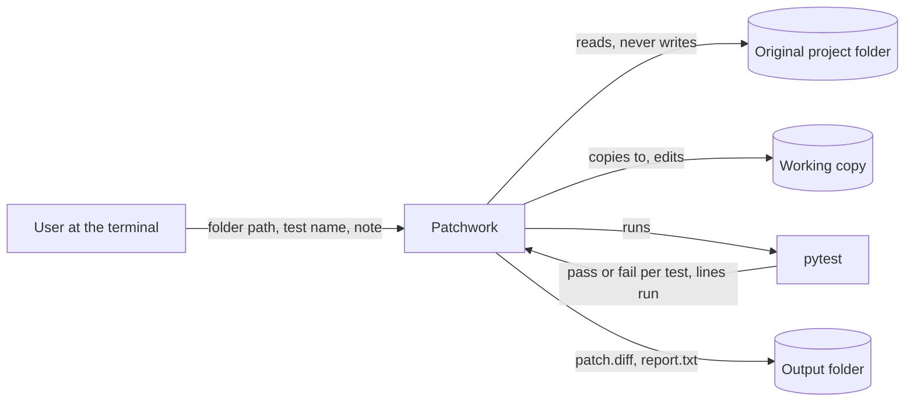
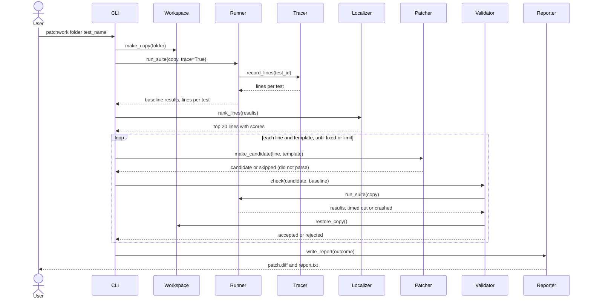
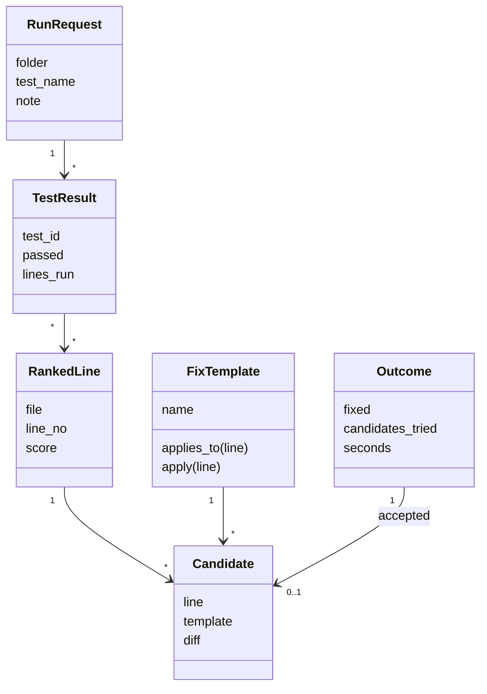
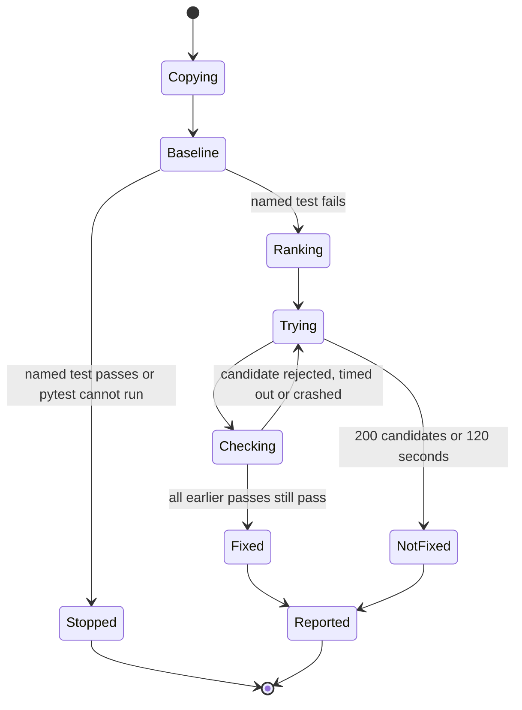

# Full Spec: Patchwork

**Team:** Zaid Sarwar, Bhargav Gondesi, Ishwar Jha  **Date:** Thu Nov 19, 2026  **Committer:** Zaid Sarwar

**Roles:** Product Owner Zaid Sarwar | Process lead Ishwar Jha | Architect Bhargav Gondesi | Quality lead Ishwar Jha | Prompt engineer Zaid Sarwar

---

## 0. The idea (Chapter 1)
- The single main problem, and for whom (one sentence): A student or developer with a small Python project has a test that just started failing and wants a small, checked fix suggested without sending their code to an AI service.
- Who is harmed if this app fails, is wrong, or leaks data? The user, if Patchwork saves a "fix" that makes the named test pass but breaks something no test covers, or if it changes their original files. Anyone who later uses that code is harmed too if the user merges a bad diff without reading it.
- Anything the app must never do (privacy, safety, legal): It must never change the original project folder, never send code or results off the computer, never call an AI model, and never run any command except pytest. It must never present a candidate as "fixed" unless every test that passed before still passes.
- Patchwork is **not a secure sandbox.** Running pytest runs the project's own code (tests, fixtures and imported modules), and that code could read files, use the network or write outside the copy. Working on a copy only protects the original from Patchwork's own edits. So this semester Patchwork runs only on our team-made sample project, which holds fictional data and no keys, passwords or personal information, and the README tells users not to run it on untrusted repositories.
- To cut down what a test can reach, pytest runs in a reduced environment (R16): its home and temp folders point to a throwaway folder, variables that hold keys or tokens are removed, and network connections are blocked while tests run. These are guard rails for honest mistakes in trusted code. A test written to get around them could, so the trusted-projects rule stays.

## 1. Process and plan (Chapters 2 and 3)  Owner: Ishwar Jha
- Process model we chose (plan-driven, incremental, or agile) and **why it fits this app** (2 sentences): We use an incremental, agile process with three short sprints, which Sommerville (Chapters 2 and 3) recommends when requirements are clear enough to start but the team needs working software early to learn from. Patchwork splits into filters that each work on their own, so every sprint can end with a tool that runs end to end, and the seeded-bug table tells us after each sprint whether the last change helped.
- Practices we actually use: sprints (three), a board (GitHub Issues in the team fork), code review on every pull request, tests on every change (`uv run pytest` must pass before merge), and a short retrospective at the end of each sprint in the team GroupMe. We do not hold daily stand-ups, because we meet in person only on Thursdays; we post a one-line status in GroupMe instead.
- **Definition of Done** (checklist, 4 or more items):
  - [ ] The change has a unit test that fails without it and passes with it.
  - [ ] `uv run pytest` passes on a clean clone.
  - [ ] Every new function has a docstring, and its test checks what the docstring promises.
  - [ ] Another team member reviewed and approved the pull request.
  - [ ] The original sample project folder is unchanged after running the tool (checked by test).
  - [ ] The requirement-to-test map in Section 6 names the new test.
- Sprint plan (what is working at the end of each sprint):

| Sprint | Working software at the end | se-agent run? |
|---|---|---|
| 1 | The minimum working version: `patchwork <folder> <test>` copies the project, runs pytest once, stops with a message if the named test passes, ranks lines with Ochiai, tries one template (bound shift by 1) and accepts it only when the full suite passes. Sample project with the first 5 seeded bugs. | Yes, run 1 (cheap model): records for Chapters 2 to 9 plus a code draft of the minimum working version, which we review against this spec |
| 2 | The other five fix templates, the 200-candidate, 120-second and 10-second limits, and the diff plus report files. Sample project grows to 10 seeded bugs. | Yes, run 2: code for the other five templates and the evaluation script, checked against our tests |
| 3 | Evaluation script printing the 10-bug results table, README steps tested on a clean machine, and the demo. Should-do items only if time is left. | Optional run 3, only if run 2 left gaps |

- Biggest schedule risk and what we will do about it: The coverage step (recording which lines each test runs with only the standard library and pytest) could take longer than planned. We build it first in Sprint 1, test it on a three-function example before anything else depends on it, and if it is still not working by the middle of Sprint 1 we narrow it to the copied project's own files only, which keeps the trace small.
- AI contribution: Claude (Opus 5.5) drafted this section from our Project Brief. The process choice, the three-sprint length and the Thursday-only meeting constraint come from the team.

## 2. Requirements (Chapter 4)  Owner (Product Owner): Zaid Sarwar
**Stakeholders and what each wants:**

| Stakeholder | Wants |
|---|---|
| Student or developer (end user) | A fix for one failing test in minutes, with a diff they can read before applying it |
| Course instructor (Cliff Whitworth) | A working app built through the Sommerville process, with requirements traced to tests and an honest account of AI use |
| Team (Zaid, Bhargav, Ishwar) | A scope three people can finish before the end of the semester, with each part owned by one person |
| Anyone who later uses the user's code | No silent behavior changes from an unreviewed patch |

**User stories** (as a ___, I want ___, so that ___), each with acceptance criteria:
1. As a student, I want to give Patchwork my project folder and the name of the failing test, so that I do not have to search the code by hand. Acceptance: with the sample project and the test for "average() crashes on an empty list," the tool prints a ranked list of lines with scores.
2. As a student, I want my original folder left alone, so that a bad candidate can never damage my work. Acceptance: a checksum of every file in the original folder is the same before and after a run.
3. As a developer, I want a fix to count only when every test that passed before still passes, so that I do not trade one bug for another. Acceptance: on a seeded bug where a template makes the named test pass but breaks another test, the tool rejects that candidate and keeps searching.
4. As a developer, I want a diff and a short report, so that I can review the change before I apply it. Acceptance: after a successful run, the output folder holds one unified diff file and one report listing the ranked lines, the template used, the candidates tried and the seconds taken.
5. As a student, I want the tool to stop and still tell me what it tried, so that a hard bug does not hang my terminal. Acceptance: on a seeded bug no template covers, the tool stops within 120 seconds or 200 candidates, prints "not fixed," and saves its report.
6. As the team, we want an evaluation script, so that we can show how many seeded bugs the templates fix. Acceptance: the script prints a table with one row per seeded bug: bug ID, fixed or not, matches the known correct fix or not, template, candidates, seconds.

**Requirements table**

| ID | Type (F = functional, NF = non-functional) | Requirement (one testable sentence) | Priority (Must/Should) | Acceptance test (input -> expected result) |
|---|---|---|---|---|
| R1 | F | The tool takes a project folder path and a pytest test name, plus an optional note of 300 characters or fewer that is copied into the report. | Must | Valid folder, valid test name, 40-character note -> run starts and the note appears in the report; a 301-character note -> error message, nothing runs |
| R2 | F | The tool works on a copy of the project, never writes inside the original folder, and compares the original's checksums at the start and end of the run. | Must | Any normal run -> checksums of the original folder match before and after; a sample test that edits a file in the original folder -> the run ends with "original folder changed" and no patch is saved |
| R3 | F | The tool runs the suite once and stops with a clear message if the named test does not fail, or if pytest cannot run the suite at all. | Must | Name of a passing test -> message "test does not fail" and exit code 1; a sample project with a syntax error in a test file -> message "pytest could not run the tests" and exit code 2; no candidates tried in either case |
| R4 | F | The tool records the lines each test runs and scores every line with the Ochiai formula; lines no failing test runs score 0 and are skipped, and ties sort by file name, then line number. | Must | Sample project, average() bug -> the line with the division ranks first or second; hand-worked example in Section 5 -> scores match to 3 decimals |
| R5 | F | The tool tries six templates (comparison swap, arithmetic swap, bound shift by 1, condition negation, and/or swap, empty-or-None guard) on the 20 highest-ranked lines, one AST node change at a time, and skips any candidate that does not parse. | Must | Seeded off-by-one bug -> the bound-shift template produces the accepted candidate; a line with `"<"` inside a string -> no candidate changes the string |
| R6 | F | Every candidate starts from the unchanged copy (any file a test run changed or added is put back first), and it counts as a fix only when the named test passes and every test that passed before still passes. | Must | Candidate that fixes the named test but breaks another -> rejected, and the next candidate's file matches the copy except for its own one change; a test that writes a data file inside the copy -> the file is gone before the next candidate |
| R7 | F | The tool saves a unified diff and a report with ranked lines and scores, template used, candidates tried, candidates that did not parse and seconds taken. | Must | Successful run -> output folder holds patch.diff and report.txt with those fields |
| R8 | F | An evaluation script runs the tool on the team-made sample project with 10 seeded bugs and prints one row per bug: bug ID, fixed or not, matches the known correct fix or not, template, candidates, seconds, plus a summary line with the share fixed and the share correct. | Must | `uv run python evaluate.py` -> table with 10 rows and six columns, then the summary line |
| R9 | NF (performance) | One run stops after 200 candidates or 120 seconds, whichever comes first. Any single test run is killed after 10 seconds, and a run that is killed, crashes or cannot collect the tests counts as a rejected candidate; the report is still saved. | Must | Seeded bug no template covers -> finishes in 120 seconds or less with "not fixed" and a saved report; a candidate that turns a loop infinite -> killed at 10 seconds, search continues; a candidate that makes pytest exit with an error and no results -> rejected, search continues |
| R10 | NF (usability) | All output is plain text, readable by a screen reader, and every error message says what to do next. | Must | Missing folder -> one line naming the path and the fix ("check the folder path") |
| R11 | NF (security or privacy) | Patchwork's own code runs no command except pytest, opens no network connection and writes only inside the copy and the output folder; pytest runs with a scrubbed environment that passes no variables whose names contain KEY, TOKEN, SECRET or PASSWORD. | Must | A code search finds one subprocess call, to pytest; a test fixture that prints the environment -> no such variables appear |
| R12 | NF (cost) | The tool calls no AI model and needs no API key, so each use costs $0. | Must | Run with no `.env` file and no key -> completes normally |
| R13 | NF (reliability) | The same input always gives the same ranked lines, candidate order, chosen template and diff; elapsed seconds may differ. | Must | Run the same input twice -> identical patch.diff and identical report lines except the seconds line |
| R14 | NF (safety) | Patchwork is documented and used only for trusted projects; the README states that it is not a sandbox and must not run untrusted repositories. | Must | README check -> the warning is in the first screen of the Usage section; the sample project holds only fictional data |
| R15 | F | Open a pull request on a new branch instead of only saving a diff. | Should | Not tested this semester |
| R16 | NF (safety) | pytest runs with its working directory set to the copy, its home and temp folders pointed at a throwaway folder that is deleted after the run, and outgoing network connections blocked while tests run. | Must | A sample test that tries to open a socket -> the connection raises an error and that test fails; a sample test that writes to the home folder -> the file lands in the throwaway folder and the real home folder is unchanged |

**Traceability and dependencies** (Run Brief Must-do -> requirements -> what must exist first):

| Must-do | Requirements | Depends on |
|---|---|---|
| 1. Work on a copy | R2 | none |
| 2. Stop if the named test does not fail | R3, R10 | R2 (copy) |
| 3. Rank lines by Ochiai | R4, R13 | R2 (copy), R3 (baseline run with coverage) |
| 4. Six templates, one change at a time | R5, R13 | R4 (ranked lines) |
| 5. Accept only if no earlier pass is lost | R6 | R3 (baseline results), R5 (a candidate) |
| 6. Diff and report | R7 | R6 (an outcome) |
| 7. Limits and "not fixed" | R9 | R5, R6 |
| 8. Evaluation script | R8 | all of the above, plus the seeded sample project |
| Constraints | R1, R10, R11, R12, R14, R16 | apply to every step |

**Out of scope** (so nobody builds it by accident):
- Languages other than Python; projects with no tests or more than 50 Python files.
- Bugs that need more than one change; more than one failing test per run.
- Writing the failing test for the user.
- A web or chat interface.
- Any AI model at run time.
- Untrusted repositories, or any repository with real personal information, API keys or confidential code.

**Requirements we removed as unnecessary, and why:**
- AI-generated patches. Bhargav's first version was an AI agent. Zaid changed it on Nov 11 to rule-based templates, because an AI call would add cost, a key and output that changes between runs (it would break R12 and R13).
- Growing the sample project from 10 to 15 seeded bugs. Moved to "Should do," because 10 already covers every template and two uncovered cases.

**Open questions** (better listed than guessed):
- How many of the 10 seeded bugs the six templates fix, and how many of those fixes match the known correct fix. The evaluation table answers it at the end of Sprint 2.
- TODO: whether per-test tracing is fast enough on a 50-file project to stay inside 120 seconds. We will time it in Sprint 1.
- TODO: whether the empty-or-None guard should return a fixed value (0, an empty list, None) or raise a clear error. We will decide from the seeded bugs in Sprint 2.
- TODO: whether 10 seconds per test run is enough for every sample test. We will time the full suite before Sprint 2.
- TODO: confirm the exact rewrite lists in Section 5 (which operator each template swaps to) against the seeded bugs. We wrote them before the sample project exists.
- TODO: whether blocking sockets and moving the home folder (R16) breaks any sample test. None should need either one. We check when the sample project is written in Sprint 1.
- Decided (safety): no OS-level sandbox or container this semester, because the constraint is the standard library plus pytest. We use the reduced environment in R16, limit use to the sample project (R14), and list what that leaves open in Section 8.

**Check:** We replaced "fast" with the 200-candidate, 120-second and 10-second limits (R9), "secure" with the single pytest command, the reduced test environment and the trusted-projects rule (R11, R14, R16), "same output" with the exact fields that must match (R13), and "easy to read" with plain text and next-step error messages (R10).
- AI contribution: Claude drafted the stakeholder table, the user stories, the acceptance tests and the traceability table from our brief and the instructor's proposal feedback. The no-AI rule, the limits and the out-of-scope list are the team's (Zaid, Nov 11). On Nov 19 Claude added R16, the crash rule in R9 and the restore rule in R6 from the same feedback.

## 3. Models (Chapter 5)  Owner (Architect): Bhargav Gondesi
**Context model** (what is inside the system, what is outside, what crosses the boundary):

Inside the system: the command line, the workspace, the test runner and coverage collector, the fault localizer, the patch generator, the validator and the reporter. Outside: the user, the original folder, pytest and the output folder. Nothing crosses to the network.

**Use cases or a sequence model for the most important story:**

**Class or data model** (main entities and how they relate):

**State model** (only if the app has modes; otherwise write "no modes"):

**Consistency check:** R13 (same input, same output) appeared in no model at first. We resolved it in the sequence model by fixing the order: lines sorted by score, then by file name and line number, and templates always tried in the order listed in R5. R9's 10-second limit was missing from the state model, so Checking now also returns to Trying when a test run is killed. The note in RunRequest is needed by R1 and R7 only, so it is not passed to the search. R16 added no new element, because the Runner sets the reduced environment and the context model already shows nothing crossing to the network. The crash case in R9 was missing from the state and sequence models, so both now name it.
- AI contribution: Claude drafted the four diagrams from our brief. The team checked that every participant in the sequence diagram is a module in Section 5.

## 4. Architecture (Chapter 6)  Owner (Architect): Bhargav Gondesi
- Pattern we chose (layered, MVC, client-server, pipe-and-filter, other): Pipe and filter, with each filter in its own module: workspace (copy) -> test runner -> coverage collector -> fault localizer -> patch generator -> validator -> reporter. Sommerville (Chapter 6) describes pipe and filter as a fit for data-processing systems where each step transforms its input, and that is what Patchwork does. Keeping each filter separate means each one can be unit-tested with a fixed input and output, without running the others.
- Which non-functional requirements drove it (name the R-numbers): R13 (same input, same output) and R9 (stop at the limit and still report) both need a fixed order of steps with clear handoffs. R2 and R11 are easier to check when only the workspace and the patch generator write files, and only the test runner starts a process. R16 follows Sommerville's advice (Chapter 6) to keep safety-related operations in one component or a small number of them: `runner.py` is the only module that starts a process and sets the test environment.
- Alternatives we rejected, and why: Layered, because a command-line tool with no stored data gains little from layers. Client-server, because R11 rules out network use. A repository pattern, because the steps pass small results forward and do not need a shared store.
- **If the app uses an AI model:** Patchwork does not use an AI model (R12). No fallback is needed, and the cost per use is $0.

**Decisions log**

| # | Decision | Alternatives | Reason (tie to an R-number) | Consequence |
|---|---|---|---|---|
| D1 | Rule-based fix templates, no AI at run time | An AI agent that writes patches (Bhargav's first idea) | R12 and R13: $0 per use and the same output every time | Fixes are limited to the six templates; two seeded bugs are expected to stay "not fixed" |
| D2 | Ochiai scoring for line ranking | Tarantula; ranking by recent edits | R4 names Ochiai, and it needs only pass or fail per test and the lines each test ran | Needs line coverage per test, which costs one traced run of the suite |
| D3 | Every candidate is checked by rerunning the full suite | Rerun only the named test | R6: a fix must keep every earlier pass | Slower search, held in check by R9's limits |
| D4 | Work only on a temporary copy | Edit in place and undo with git | R2: the original folder must never change | Disk use doubles for the length of the run (fine at 50 files or fewer). The copy is not a security boundary (R14) |
| D5 | Find edit targets with the `ast` module and change only that node's exact source span | Plain text search and replace on the line | R5: strings and comments must never be changed, and each candidate must parse | The rest of the file keeps its formatting, so the diff shows only the one change |
| D6 | Kill any test run after 10 seconds and treat it as a rejected candidate | Wait for the 120-second total only | R9: a template can turn a loop infinite, and one hang must not use the whole budget | A slow but correct test could be rejected; we time the sample suite before Sprint 2 (open question) |
| D7 | Run tests in a reduced environment: throwaway home and temp folders, scrubbed variables, sockets blocked | An OS-level sandbox or a container; no isolation at all | R16 and the standard-library constraint: a container would add a dependency and a setup step for every user | Stops accidental network use and stray writes to the home folder. It does not stop code written to get around it, so R14 stays |

- AI contribution: Claude drafted the alternatives and the decisions table. D1 is Zaid's ruling from Nov 11; the Ochiai and seeded-bug ideas are Bhargav's. D7 was added on Nov 19 from the instructor's recommendation to run tests in an isolated environment.

## 5. Design and implementation (Chapter 7)  Owner: Bhargav Gondesi
- Modules, and the owner of each:

| Module | Owner | Responsibility |
|---|---|---|
| `cli.py` | Zaid Sarwar | Reads and checks the arguments (R1, R10), runs the filters in order, enforces the 200-candidate and 120-second limits (R9), prints the outcome |
| `workspace.py` | Ishwar Jha | Makes the temporary copy and the throwaway home folder, computes folder checksums, and puts the copy back to its baseline after each candidate (R2, R6, R16) |
| `runner.py` (test runner) | Bhargav Gondesi | Runs pytest on the copy in the reduced environment with a 10-second limit per run, and turns a hang, a crash or a failed collection into one "rejected" result (R3, R9, R11, R16) |
| `tracer.py` (coverage collector) | Bhargav Gondesi | The pytest plugin that records the lines each test runs (R4) |
| `netguard.py` | Bhargav Gondesi | A second pytest plugin that makes socket connections raise an error while tests run (R16) |
| `localizer.py` (fault localizer) | Bhargav Gondesi | Ochiai score per line, tie order and the top 20 (R4, R13) |
| `templates.py` (patch generator) | Zaid Sarwar | The six fix templates, one function each, using `ast` to find and change one node (R5) |
| `validator.py` | Ishwar Jha | Compares a candidate's results with the baseline: named test passes and no earlier pass is lost (R6) |
| `reporter.py` | Ishwar Jha | Writes patch.diff and report.txt (R7) |
| `evaluate.py` and `sample_project/` | Ishwar Jha | The 10 seeded bugs, their known correct fixes and hidden tests, and the results table (R8) |

**How fault localization works (R4)**
- Collecting coverage: `runner.py` starts pytest once on the copy with our coverage collector, `tracer.py`, loaded as a pytest plugin with `-p`. Around each test, the plugin turns on `sys.settrace`, records every (file, line) it runs inside the copy, and writes one JSON file mapping each test ID to its lines and its pass or fail result. This uses only the standard library and pytest.
- Scoring: for each line, ef = failing tests that run it, nf = failing tests that do not, ep = passing tests that run it. Ochiai score = ef / sqrt((ef + nf) x (ef + ep)).
- Worked example: the sample project has one failing test (average of an empty list) and four passing tests. The division line in `average()` is run by the failing test and by one passing test: 1 / sqrt((1 + 0) x (1 + 1)) = 0.707. The `return` line in a helper that all five tests run scores 1 / sqrt(1 x 5) = 0.447. A line only passing tests run has ef = 0, so it scores 0 and is skipped. The division line ranks first.
- Ties and no coverage: equal scores sort by file name, then line number (R13). Lines no test runs never enter the list.

**How a candidate is made safely (R5, R6)**
- `templates.py` parses the file with `ast` and looks only at nodes whose line is the ranked line: Compare operators, BinOp operators, integer constants used as bounds, If and While conditions, BoolOp, and function arguments for the guard. Because targets are AST nodes, text inside strings and comments is never touched.
- The template replaces only that node's exact span (from `ast.get_source_segment` and the node's column offsets), so the rest of the file keeps its formatting.
- The new text is parsed again with `ast.parse`. A SyntaxError means the candidate is skipped and counted under "did not parse" in the report.
- `workspace.py` keeps the copy's original text in memory; `templates.py` writes one candidate, `validator.py` runs the suite through `runner.py`, and `workspace.py` writes the original text back, and undoes any other file change in the copy, before the next candidate, so a rejected change never affects later tests.

**The six templates as exact rules (R5, R13)**

Templates are tried in the order below. On one line, targets go left to right by start column. For one target, rewrites go in the order listed. A candidate whose file text matches one already tried is skipped.

| # | Template | AST target on the ranked line | Rewrites, in order |
|---|---|---|---|
| 1 | Comparison swap | Each operator in a `Compare` node | `<` to `<=`, `<=` to `<`, `>` to `>=`, `>=` to `>`, `==` to `!=`, `!=` to `==`. Then the mirrored direction for the four ordering operators (`<` to `>`, `<=` to `>=`, `>` to `<`, `>=` to `<=`). `is`, `in` and their negations are left alone |
| 2 | Arithmetic swap | The operator of a `BinOp` node | `+` to `-`; `-` to `+`; `*` to `/`; `/` to `*`, then to `//`; `//` to `/`. `%` and `**` are left alone |
| 3 | Bound shift by 1 | An integer constant used as a bound (in a comparison, a `range()` call, an index or a slice), or a `range()` or slice bound that is not a constant | A constant `n` to `n + 1`, then `n - 1`. Any other bound `e` to `e + 1`, then `e - 1` |
| 4 | Condition negation | The test of an `if`, a `while` or a conditional expression | `cond` to `not (cond)` |
| 5 | and/or swap | A `BoolOp` node | `and` to `or`, or `or` to `and`, for the whole node |
| 6 | Empty-or-None guard | The function that contains the ranked line, once per parameter in signature order, skipping `self` and `cls` | Insert as the first statement a check for `None`, then a check for an empty value (`len(param) == 0`). What the guard returns is an open question in Section 2 |

The guard is the one template that adds a statement. It is still one change: one inserted `if` block.

**What happens when a test run goes wrong (R2, R6, R9, R16)**

| Case | How Patchwork notices | What it does |
|---|---|---|
| A test run hangs | `subprocess.run` is called with `timeout=10` and raises `TimeoutExpired` | Kills the pytest process, counts the candidate as rejected, restores the copy and moves to the next candidate |
| pytest crashes or cannot collect the tests | The exit code is not 0 (all passed) or 1 (some failed), or the results file is missing | Same as a hang. On the baseline run, the tool stops with "pytest could not run the tests" (R3) |
| A test changes files inside the copy | After each candidate, `workspace.py` compares the copy's checksums with the baseline | Puts back every file that differs and deletes files that were added, so the next candidate starts clean (R6) |
| A test writes to the home or temp folder | Those paths point to the throwaway folder: `runner.py` sets HOME, USERPROFILE, TMPDIR, TEMP and TMP (R16) | The folder is deleted at the end of the run |
| A test tries to use the network | `netguard.py` replaces `socket.socket.connect` and `connect_ex` with a function that raises `OSError` (R16) | That test fails at the connection line. Code that reaches the network without Python's `socket` module is not stopped |
| A test changes the original folder | Checksums of the original at the start and end of the run (R2) | Ends with "original folder changed", lists the files and saves no patch |
| A test writes somewhere else on the disk by absolute path | Patchwork cannot see this | Not prevented. This is why R14 limits use to our own sample project |

- Where the logic lives **apart from the display** (so it can be unit-tested): All logic is in the modules above, as small functions with one or two inputs and outputs. Only `cli.py` prints to the terminal, so every other function can be unit-tested without capturing output.
- Why the modules are this small (Sommerville): Chapter 6 ties maintainability to fine-grain, self-contained components, so each filter is its own module and can be replaced without touching the others. Chapter 7 names reuse, configuration management and host-target development as the implementation issues to plan for. Ours are the reuse list and the branching rule below, and the host is also the target, because Patchwork is built and run on the same laptops.
- Design patterns we will use, and where (or "none yet"): Strategy, in `templates.py`: each template has the same two operations (`applies_to(line)` and `apply(line)`), so `cli.py` loops over a list of templates and adding one never touches the others.
- Code or libraries we will reuse, with their licenses: Python 3.12 standard library (PSF License: `ast`, `difflib`, `shutil`, `tempfile`, `subprocess`, `sys.settrace`) and pytest (MIT). Patchwork itself is MIT, like se-agent.
- Branching and review rule (for example: pull request, one approval, tests green): One branch per issue, a pull request into main, one approval from another member, and `uv run pytest` green before merge. Nobody pushes straight to main after Sprint 1 starts.
- Technical debt we are knowingly accepting: Coverage through `sys.settrace` is slower than a coverage library; we accept that to keep the standard-library-only constraint. Templates work on one line at a time, so multi-line bugs are out of scope.
- AI contribution: Claude proposed the module split and the Strategy pattern, following the instructor's feedback to separate the runner, coverage collector, fault localizer, patch generator, validator and reporter. Module owners are the team's choice. On Nov 19 Claude drafted the template rules table and the went-wrong table. The team still has to confirm the rewrite lists (open question in Section 2).

## 6. Testing (Chapter 8)  Owner (Quality lead): Ishwar Jha
**Requirement-to-test map** (every Must-do needs at least one):

| Requirement | Test (file::name) | Type (unit / component / system / user) | How we will check it can fail |
|---|---|---|---|
| R1 | tests/test_cli.py::test_note_over_300_chars_rejected | unit | Raise the limit to 400 in the code; the test must fail |
| R2 | tests/test_workspace.py::test_original_folder_unchanged, ::test_reports_original_folder_changed | system | Make the search write to the original path once; the checksum test must fail. Skip the end-of-run comparison; the second test must fail |
| R3 | tests/test_runner.py::test_stops_when_named_test_passes, ::test_stops_when_pytest_cannot_run | component | Name a test that fails; the test must fail because candidates start. Read a failed collection as an ordinary test failure; the second test must fail |
| R4 | tests/test_localizer.py::test_ochiai_known_values | unit | Uses the worked example in Section 5 (0.707 and 0.447); swap the formula's denominator and the scores must not match |
| R5 | tests/test_templates.py::test_each_template_one_change, ::test_string_literal_untouched, ::test_rewrites_in_listed_order | unit | Make one template change two tokens, use plain text replace, or reverse a rewrite list; the one-change, string or order assertion must fail |
| R6 | tests/test_validator.py::test_rejects_fix_that_breaks_other_test, tests/test_workspace.py::test_copy_restored_after_candidate | component | Check only the named test; the seeded case must then wrongly report "fixed". Skip the restore; the leftover file must be found |
| R7 | tests/test_reporter.py::test_report_fields_present | unit | Remove the seconds field; the test must fail |
| R8 | tests/test_evaluate.py::test_table_has_ten_rows | system | Remove one seeded bug; the row count must fail |
| R9 | tests/test_cli.py::test_stops_at_candidate_limit, tests/test_runner.py::test_hanging_test_killed, ::test_crashed_run_is_rejected | component | Set the limit to 201, remove the 10-second timeout, or read a crash as a pass; the counter, timing or outcome assertion must fail |
| R10 | tests/test_cli.py::test_missing_folder_message | unit | Change the message text; the assertion must fail |
| R11 | tests/test_runner.py::test_only_pytest_is_run, ::test_env_is_scrubbed | unit | Add a second subprocess call, or pass the full environment; the mock or the environment check must fail |
| R12 | tests/test_cli.py::test_runs_without_env_or_key | system | Import an AI client at start; the run must error without a key |
| R13 | tests/test_cli.py::test_same_input_same_diff | system | Shuffle tied lines randomly; two runs must give different diffs or candidate orders |
| R14 | tests/test_docs.py::test_readme_has_not_a_sandbox_warning | unit | Delete the warning from the README; the test must fail |
| R16 | tests/test_runner.py::test_socket_blocked, ::test_home_is_throwaway | component | Unload the guard plugin, or pass the real home folder; the sample test's connection or write then succeeds and the assertion must fail |

**The three most important tests, in plain language** (input -> expected result):
1. Sample project and the failing test for "average() crashes on an empty list" -> a ranked list, an accepted empty-input guard and a diff where all tests pass.
2. A seeded bug where one template fixes the named test but breaks another -> that candidate is rejected and the report lists it as tried.
3. The same folder and test run twice -> two byte-for-byte identical diff files, and the original folder's checksums unchanged.

- Why these levels (Sommerville, Chapter 8): development testing has three levels, unit, component and system, and the map above uses all three. User testing is the fourth entry, with a classmate. The map is our verification: each requirement is checked against this spec. The classmate's run is our validation: we find out whether the report is something a user would trust. Sommerville also repeats Dijkstra's point that testing can show errors are present but not that none are left. That is why a candidate that passes every visible test is reported as "fixed" and is called "correct" only when the hidden tests pass too.
- Regression rule: every seeded-bug run in `evaluate.py` and every acceptance criterion in the Run Brief is also a pytest system test, so `uv run pytest` reruns them after every change. A pull request that turns any of them red is not merged (Definition of Done). Inside Patchwork, R6 is the same idea: a candidate that loses any earlier pass is a regression and is rejected.
- Edge cases we will try to break each Must-do with (zero, negative, empty, huge, missing): an empty note and a note of exactly 300 characters; a missing folder; a folder with no tests; a test name that does not exist; a project of exactly 50 Python files and one of 51; a line ranked with a score of zero; a bug no template covers; a test that takes longer than 10 seconds on its own.
- Passing tests versus a correct fix: a candidate can make every available test pass and still be wrong. For each seeded bug we keep the known correct fix and two extra hidden tests that the tool never sees. The evaluation script reports "fixed" (all visible tests pass) and "correct" (the diff matches the known fix, or the hidden tests also pass) as separate columns, and it also reports the share fixed, the share correct, candidates tried and candidates that did not parse.
- User testing: one classmate outside the team who uses Python but has not seen Patchwork. They run it on the sample project from the README alone, and we want to learn whether the report tells them what changed and whether they would trust the diff.
- What we are deliberately **not** testing, and why: projects over 50 files and multi-line bugs (out of scope), the pull-request Should-do (not built this semester), and Windows path quirks beyond one manual run on Zaid's PC.
- Test command: `uv run pytest`
- AI contribution: Claude drafted the map and the edge cases. The "how we will check it can fail" column follows Whitworth's in-class rule that every function gets a docstring and a unit test of what the docstring says. On Nov 19 Claude added the R16 row, the extra tests for R2, R3, R5, R6 and R9, and the Sommerville paragraph.

## 7. Evolution (Chapter 9)  Owner: Zaid Sarwar
- The most likely future change: Adding new fix templates once the evaluation table shows which seeded bugs stay "not fixed" (for example, swapping a function's argument order or changing a wrong variable name).
- Impact analysis: modules, models, requirements and tests that would change, and about how long: `templates.py` gets one new function; `localizer.py`, `validator.py` and the other modules do not change. R5 changes from six templates to seven, the class model gains nothing new (the template is another FixTemplate), `tests/test_templates.py` gets one test, and the sample project may gain one seeded bug. About two to three hours per template.
- What design choice today would make that change easier: Keeping every template behind the same two operations (Section 5, Strategy pattern) and keeping the template list in one place, so the search never names a template directly.
- How this fits Sommerville (Chapter 9): he sorts maintenance into fault repairs, environmental adaptation and functionality addition. A new template is functionality addition, the type that takes the largest share of maintenance effort, so the design keeps it to one file and one test. A Python release that changes `ast` or `sys.settrace` would be environmental adaptation, and it would touch `templates.py` and `tracer.py` only. If the list grows past about ten templates, we would refactor `templates.py` into one file per template first. Sommerville treats refactoring as preventive maintenance.
- Limits that later versions inherit: bug classes no template covers (a change on more than one line, a wrong variable name, a missing statement) end as "not fixed". A correct candidate whose tests need more than 10 seconds is rejected (D6). "Fixed" means the visible tests pass, which is weaker than "correct" (Section 6). Tests still run with the user's file permissions (R14, R16).
- AI contribution: Claude drafted the impact analysis. Choosing template growth as the likely change came from the seeded-bug evaluation idea (Bhargav). On Nov 19 Claude added the Sommerville and limits bullets.

## 8. Decisions we are least sure about
(Prepare to be asked about these.)
- Whether `sys.settrace` coverage stays inside 120 seconds on a 50-file project (D2, R9).
- Whether rerunning the full suite for every candidate is too slow with 20 lines times six templates (D3). If it is, we will order templates by how often they fixed seeded bugs, which still keeps R13.
- Whether two uncovered seeded bugs out of 10 is the right share to show the tool's limits honestly.
- Whether the reduced test environment (R16) plus limiting use to our own sample project (R14) is enough safety without an OS-level sandbox. It is enough for this course. It would not be enough for real users, because a test can still read or write any file by its absolute path.

## 9. Run plan and cost (se-agent)  Owner (Prompt engineer): Zaid Sarwar
- Prompts in `prompts/` we will use, in order: ch02_software_processes, ch03_agile_development, ch04_requirements_engineering, ch05_system_modeling, ch06_architectural_design, ch07_design_implementation, ch08_software_testing, ch09_software_evolution. The router picks the order from each prompt's Role and Task; this is the order we expect. None of the eight writes code files, so we add an implementer prompt (`implementer.md`, 8-section template, one fenced block per file) before run 1. TODO: Zaid writes it this week.
- Model (use `gpt-6-luna` for iteration; ask before using a stronger one): gpt-6-luna for every run.
- What the coding agent should build first, and how we check it: run 1 asks for the minimum working version only (workspace, runner, tracer, localizer, one template, validator, reporter). Before we merge any of it, we check: every file has a docstring and a unit test, `uv run pytest` passes, the Ochiai unit test matches the worked example in Section 5, and running it on seeded bug 1 leaves the original folder's checksums unchanged. Anything that fails a check becomes an issue for the owner in Section 5, and nothing the agent wrote is merged without the same review as human code. Run 2 adds the other five templates and the evaluation script, checked the same way.
- Planned runs (default: one per sprint):

| Run | Sprint | Prompts | Model | Estimated cost (`uv run python cost_estimate.py docs/RUN_BRIEF.md`) |
|---|---|---|---|---|
| 1 | 1 | The eight prompts above plus the implementer prompt | gpt-6-luna | $0.01 light (4 steps), $0.02 typical (6 steps), $0.04 heavy (8 steps), measured with the eight prompts; to be rerun with the implementer prompt |
| 2 | 2 | ch07, ch08 and the implementer prompt, with run 1's records as prior work | gpt-6-luna | About $0.02 to $0.05 (to be rerun with `cost_estimate.py` once the implementer prompt exists) |

- Before we request a run, we confirmed: `uv run pytest` passes / Run Brief is 4,000 characters or fewer / each prompt follows the 8-section template

## 10. Run Brief
The Run Brief is `docs/RUN_BRIEF.md`. It starts from the Project Brief we submitted on Wed Nov 11 (docs/project_brief.md, 3,819 characters) and adds what the instructor's feedback asked for: the not-a-sandbox rule, the reduced test environment, AST-based edits, a fresh start for every candidate, the 10-second limit, what counts as a crash, tie handling, and "same output" defined without the seconds. We cut the nine Must-dos to eight and gave each one a single behavior. The input rules moved to Constraints, and "still save the report" is covered by the Acceptance criteria. The how-to details (coverage, AST edits, ties, timeouts) are in Constraints, as the feedback suggested. The Open questions section now lists the technical and safety questions that are still open.

- Characters in our Run Brief: 3,992
- What we cut to fit, and why it was safe to cut: the 15-bug Should-do (it stays in this Full Spec), "One terminal command runs it" (the README covers it), "No web server, no database" (the standard-library constraint already rules both out), the MIT license line (Section 5 names the license), "They run it when a test starts failing" (the first section already says when) and the 10-second question (it stays in the Open questions of Section 2). The exact rewrite list for each template is in Section 5 only, and the brief names the six templates. Stakeholders, process, the models, the decisions log and the test map stay only in this Full Spec, because the agents need the Must-dos, limits and acceptance checks to draft the app, and those are all in the Run Brief in words.

## 11. Presentation notes (six beats; every member speaks)
| Beat | Who | One sentence we will say |
|---|---|---|
| 1. Problem, user, Must-dos (Ch 4) | Zaid Sarwar | Patchwork gives a student a reviewed, rule-based fix for one failing Python test in two minutes or less, without sending their code anywhere. |
| 2. Process choice and Definition of Done (Ch 2, 3) | Ishwar Jha | We worked in three sprints, and nothing counted as done until it had a test that could fail and another member's approval. |
| 3. Context model and one more model (Ch 5) | Bhargav Gondesi | The context model shows Patchwork only reads the original folder and only runs pytest, and the state model shows it always ends in a saved report. |
| 4. One architecture decision: chosen, rejected, which requirement forced it (Ch 6) | Bhargav Gondesi | We chose rule-based templates over an AI agent, because R12 and R13 require $0 per use and the same output every time. |
| 5. Three most important tests, and how we know they can fail (Ch 8) | Ishwar Jha | Our key tests prove the original folder never changes, a fix that breaks another test is rejected, and two runs give the same diff, and each one fails when we break that rule on purpose. |
| 6. Likely change, Run Brief, cost plan (Ch 9, 4) | Zaid Sarwar | A new template touches one file and one test, our Run Brief is 3,992 characters, and each se-agent run costs about two cents on gpt-6-luna. |
